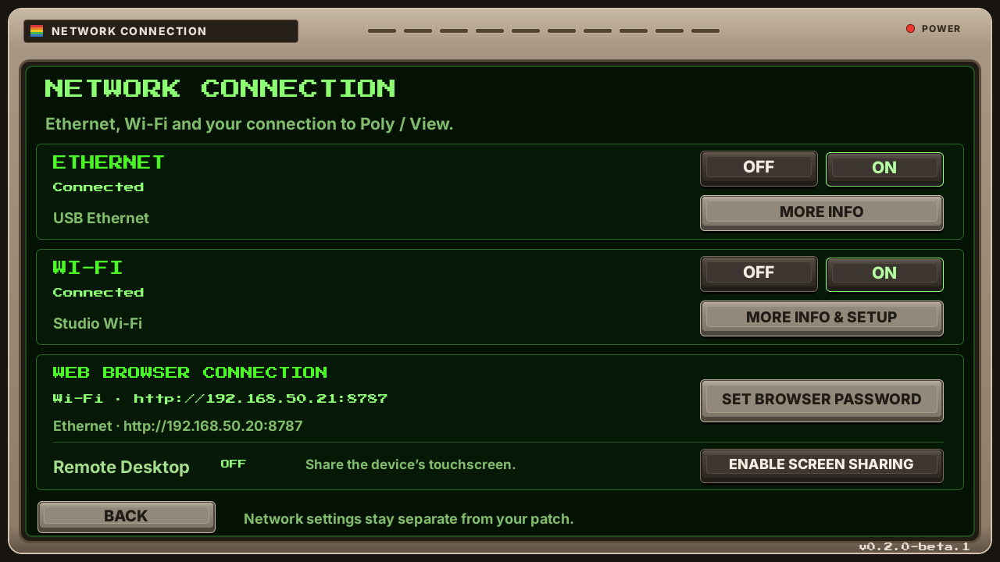
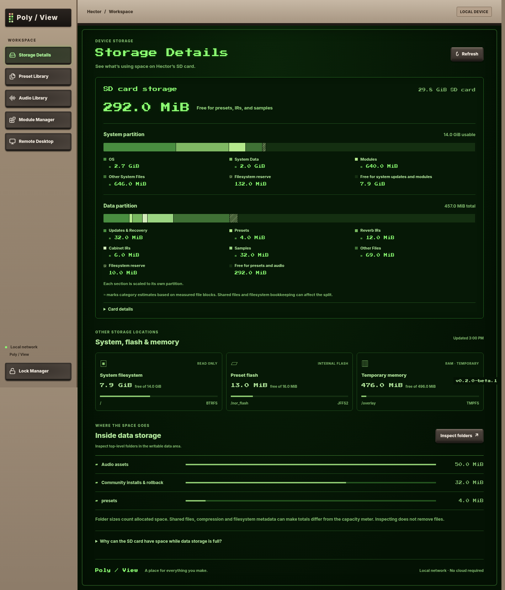
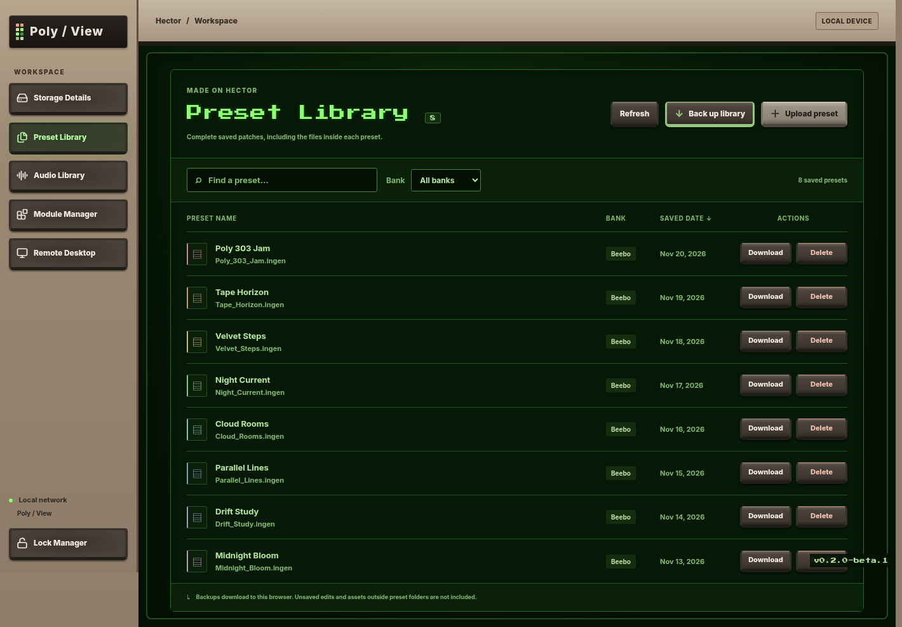
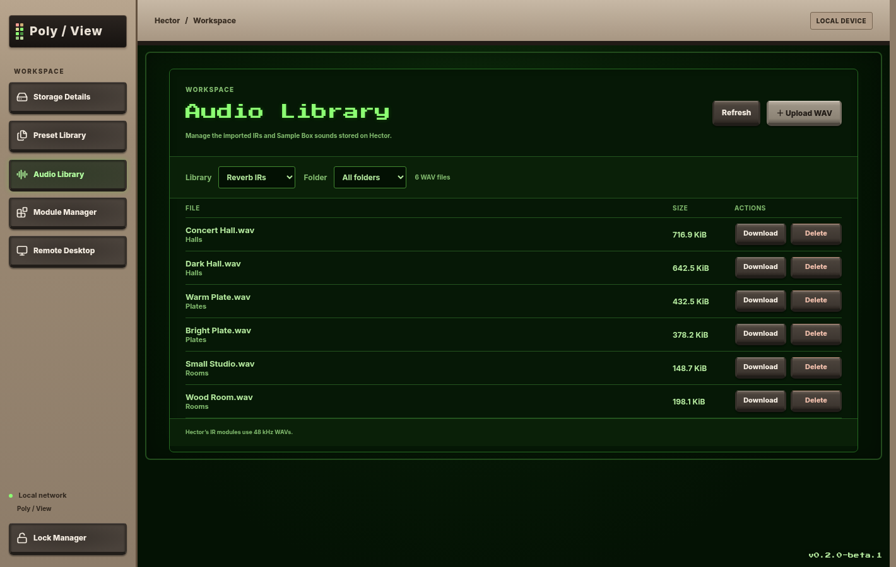
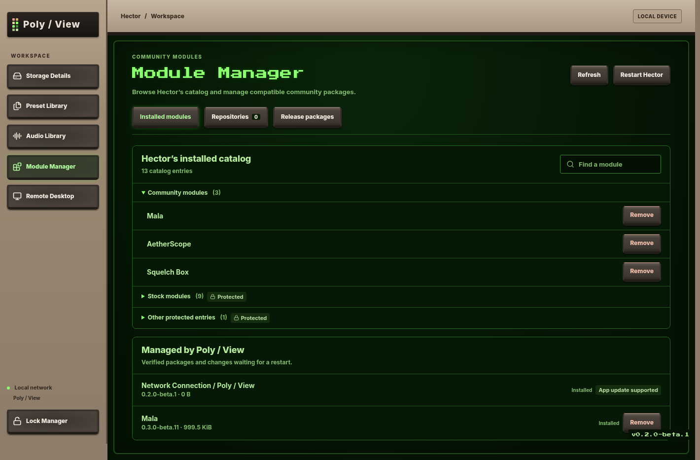
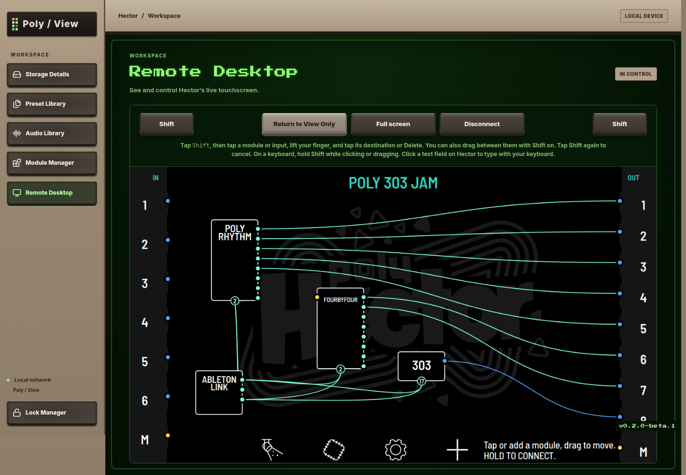

# Network Connection / Poly / View for Hector

Network Connection sets up Ethernet and Wi-Fi on Hector. Poly / View is its local browser workspace for storage, presets, audio, community modules, and remote desktop.

**First public beta · Hector firmware 4.0.7 · v0.2.0-beta.1**

[Download the signed USB installer](https://github.com/jahmontee/network-connection-poly-view/releases/download/v0.2.0-beta.1/Network-Connection-Poly-View-Hector-0.2.0-beta.1-USB.zip) · [All releases](https://github.com/jahmontee/network-connection-poly-view/releases)

## Screenshots

*The screens use example data. Remote Desktop shows the Poly 303 Jam patch on Hector’s canvas.*

### Network Connection

### Storage Details

### Preset Library

### Audio Library

### Module Manager

### Remote Desktop

## What it does

- Set up Ethernet, Wi-Fi, and browser access from the touchscreen.
- Use Poly / View to manage presets, samples, impulse responses, and verified community releases.
- View and control Hector’s touchscreen from a browser on the same network.
- Install and update with a signed release. The original USB installation works offline.

## Install and use

Start with Hector firmware 4.0.7 and save your patch. Extract the ZIP directly to the root of a FAT32 USB drive, power Hector off, insert the drive, and power it back on. Allow up to six minutes for the USB installation to finish, depending on your SD card’s speed. A stock card restarts twice. Leave the drive inserted until the second restart finishes and Network Connection shows `v0.2.0-beta.1`. The patch canvas can appear for about a minute before the final restart.

Open **Network Connection** on Hector to set a browser password and find the local Poly / View address. For an update from a supported install, upload the original ZIP in **Module Manager → Release packages** and choose **Update**. Hector restarts automatically after the update.

The signed installer includes two Linux storage repairs. The same ZIP contains both the hardware USB entry point and the data that Module Manager verifies for an update. See the [release notes](https://github.com/jahmontee/network-connection-poly-view/releases/tag/v0.2.0-beta.1) for compatibility and recovery details.

## Source and credits

This is an independent community release. See [CREDITS.md](CREDITS.md) for upstream projects and license terms. The release includes the exact platform source and the source for the Linux storage repairs as separate downloads.
